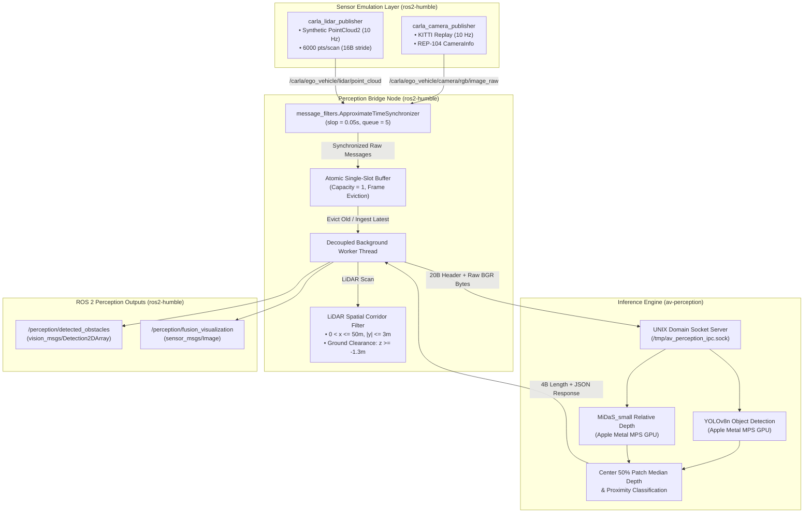

# Nexvia AIML-04: Autonomous Driving Perception Stack

[-blue.svg)](#16-hardware-and-software-requirements)
[-orange.svg)](#11-ros-2-architecture-nodes-and-topics)
[-purple.svg)](#3-yolov8n-object-detection)
[](#19-testing-and-validation-results)

An end-to-end, multi-modal autonomous vehicle perception architecture optimized for Apple Silicon (macOS arm64). This repository implements synchronized dual-sensor ingestion (camera and LiDAR), deep learning object detection, multi-object tracking, classical computer vision lane boundary extraction, monocular relative depth estimation, obstacle-distance association, ONNX runtime deployment, and a decoupled ROS 2 Humble bridge with mathematically conserved frame accounting.

---

## Table of Contents
1. [Project Overview and Objectives](#1-project-overview-and-objectives)
2. [System Architecture](#2-system-architecture)
3. [YOLOv8n Object Detection](#3-yolov8n-object-detection)
4. [ByteTrack Multi-Object Tracking](#4-bytetrack-multi-object-tracking)
5. [OpenCV Lane Detection](#5-opencv-lane-detection)
6. [MiDaS Monocular Depth Estimation](#6-midas-monocular-depth-estimation)
7. [Obstacle Depth Fusion](#7-obstacle-depth-fusion)
8. [KITTI Dataset Preparation & Partitioning](#8-kitti-dataset-preparation--partitioning)
9. [ONNX Export and Standalone Inference](#9-onnx-export-and-standalone-inference)
10. [PyTorch MPS vs. ONNX Runtime CPU Benchmarking](#10-pytorch-mps-vs-onnx-runtime-cpu-benchmarking)
11. [ROS 2 Architecture, Nodes, and Topics](#11-ros-2-architecture-nodes-and-topics)
12. [Camera–LiDAR Integration Status](#12-camera--lidar-integration-status)
13. [CARLA Simulation Adaptation & Hardware Limitations](#13-carla-simulation-adaptation--hardware-limitations)
14. [NVIDIA TensorRT Limitations & Apple MPS Acceleration](#14-nvidia-tensorrt-limitations--apple-mps-acceleration)
15. [Weights & Biases (W&B) Status](#15-weights--biases-wb-status)
16. [Hardware and Software Requirements](#16-hardware-and-software-requirements)
17. [Installation & Reproduction Instructions](#17-installation--reproduction-instructions)
18. [Project Directory Structure](#18-project-directory-structure)
19. [Testing and Validation Results](#19-testing-and-validation-results)
20. [Known Limitations & Future Roadmap](#20-known-limitations--future-roadmap)

---

## 1. Project Overview and Objectives

The objective of the **Nexvia AIML-04 Autonomous Driving Perception Stack** is to build a robust, modular perception pipeline capable of operating within the strict memory and compute boundaries of edge hardware—specifically an Apple MacBook Air M1 with 8 GB unified RAM.

### Core Goals:
- **2D Obstacle Detection**: Detect road obstacles (`person`, `bicycle`, `car`, `motorcycle`, `bus`, `truck`) accelerated via Apple Metal Performance Shaders (`mps`).
- **Multi-Object Tracking**: Maintain trajectory persistence across video frames using ByteTrack.
- **Structural Lane Geometry**: Extract driving lane boundaries, curvature radius, and vehicle center offset using classical computer vision without deep networks.
- **Monocular Depth Awareness**: Infer relative inverse disparity via MiDaS_small and associate depth heuristics to detected obstacle bounding boxes.
- **Multi-Sensor ROS 2 Bridge**: Ingest camera frames and 3D LiDAR point clouds concurrently, synchronizing them with strict slop budgets, a single-slot worker queue, and an isolated UNIX domain socket IPC architecture.
- **Deployment & Portability**: Export trained checkpoints to open standards (ONNX) and conduct rigorous empirical benchmarking comparing native Apple MPS GPU against CPU runtime execution.

---

## 2. System Architecture

The perception pipeline is decoupled into two independent execution environments connected via a high-throughput binary UNIX domain socket to prevent deep learning execution from blocking real-time ROS 2 message queues.



---

## 3. YOLOv8n Object Detection

Implemented in `test_detection.py` and integrated into the IPC server.

- **Model Architecture**: Ultralytics YOLOv8 Nano (`yolov8n.pt`, 3.15M parameters, 8.7 GFLOPs).
- **Execution Engine**: Native PyTorch 2.14.1 on Apple Silicon Metal Performance Shaders (`torch.device("mps")`).
- **Filtered Classes**: Restricted to autonomous driving obstacles:
  - `0: person`, `1: bicycle`, `2: car`, `3: motorcycle`, `5: bus`, `7: truck`.
- **Latency Breakdown**:
  - **Isolated YOLO-only inference**: **9.38 ms** on Apple MPS (dedicated benchmark).
  - **Full perception pipeline**: **~140 ms – 150 ms** end-to-end (image decoding, YOLO detection, MiDaS depth, fusion, IPC transmission, and ROS 2 publishing).
- **Output Artifact**: `detection_output.jpg`.

---

## 4. ByteTrack Multi-Object Tracking

Implemented in `track_video.py`.

- **Algorithm**: ByteTrack with low-confidence bounding box association for robust tracking through occlusions.
- **Features**:
  - Assigns unique persistent track IDs to vehicles and pedestrians across consecutive frames.
  - Maintains 30-frame historical trajectory centroids (motion breadcrumb trail).
  - Real-time tallying of cumulative unique vehicle and pedestrian counts.
  - Video rendering pipeline using OpenCV `VideoWriter`.
- **Demonstration Media**:
  - Input: `sample_traffic_stream.mp4` (5.2 MB)
  - Tracked Output: `tracked_output.mp4` (5.7 MB)

---

## 5. OpenCV Lane Detection

Implemented in `lane_detection.py`.

A deterministic classical computer vision pipeline:
1. **Color Thresholding**: Conversion to HLS color space; white lane extraction ($L > 180$) and yellow lane extraction ($H \in [15, 35], S > 70, L > 60$).
2. **Gradient Filtering**: Gaussian blur ($5 \times 5$) and Canny edge detection (thresholds 50 / 150).
3. **Region of Interest (ROI)**: Trapezoidal mask isolating the vehicle driving corridor.
4. **Inverse Perspective Mapping (IPM)**: Perspective warp converting forward-facing road perspective to top-down Bird's Eye View (BEV).
5. **Curve Fitting**: Vertical histogram peak detection followed by a 9-window sliding search to extract lane pixels; 2nd-order polynomial fit ($x = Ay^2 + By + C$).
6. **Telemetry Computation**:
   - Radius of road curvature in meters:
     $$R_{curve} = \frac{(1 + (2Ay + B)^2)^{3/2}}{|2A|}$$
   - Vehicle lateral offset from lane center:
     $$\Delta x_{offset} = \left(\frac{x_{left} + x_{right}}{2} - x_{center}\right) \times \text{meters\_per\_pixel}$$
7. **Visual Overlay**: Unwarped BEV polygon overlaid onto the original camera perspective: `lane_detection_output.jpg`.

---

## 6. MiDaS Monocular Depth Estimation

Implemented in `depth_estimation.py`.

- **Model**: `MiDaS_small` (Intel ISL, ~80 MB checkpoint).
- **Asset Loading**: Loaded locally from cached checkpoints in `~/.cache/torch/hub/intel-isl_MiDaS_master`; zero internet downloads required during runtime.
- **Compute Acceleration**: Apple Silicon MPS GPU offload.
- **Latency**: **~52.8 ms – 60.2 ms** isolated inference time on Apple MPS.
- **Output Characteristics**: Produces continuous frame-relative inverse disparity. Rejects non-finite values (NaN/Inf) and normalizes dynamically to $[0, 255]$ with degenerate range protection ($\Delta < 10^{-6}$).
- **Output Artifact**: Side-by-side colorized inferno depth map: `depth_output.jpg`.

---

## 7. Obstacle Depth Fusion

Implemented in `obstacle_depth_fusion.py` and integrated into the IPC inference server.

- **Fusion Strategy**:
  - 2D bounding boxes $[x_1, y_1, x_2, y_2]$ from YOLOv8n are mapped onto the normalized MiDaS disparity map.
  - To eliminate background contamination (sky, road surface, adjacent lane barriers), depth is sampled exclusively from the **center 50% interior patch** of each bounding box:
    $$x_{c1} = x_1 + 0.25(x_2 - x_1), \quad x_{c2} = x_2 - 0.25(x_2 - x_1)$$
    $$y_{c1} = y_1 + 0.25(y_2 - y_1), \quad y_{c2} = y_2 - 0.25(y_2 - y_1)$$
  - The patch metric is computed as the statistical **median** of disparity values.
- **Proximity Categorization**:
  - `NEAR` ($\text{Disparity} \ge 160$): Immediate proximity warning (Red bounding box).
  - `MEDIUM` ($90 \le \text{Disparity} < 160$): Cautionary mid-range obstacle (Yellow bounding box).
  - `FAR` ($\text{Disparity} < 90$): Far obstacle / clear path (Green bounding box).
- **Visual Artifact**: `fusion_output.jpg`.

> [!IMPORTANT]
> **Heuristic Relative Metric Disclaimer**: MiDaS inverse disparity scores ($[0, 255]$) and categorical proximity tags (`NEAR`, `MEDIUM`, `FAR`) are frame-relative heuristic indicators, not calibrated metric distances in meters. They indicate visual closeness relative to other features in the frame and must not be used for closed-loop longitudinal braking without metric sensor calibration.

---

## 8. KITTI Dataset Preparation & Partitioning

Implemented in `convert_kitti_to_yolo.py` and `partition_kitti_dataset.py`.

- **Data Source**: 7,481 training camera images (`image_2/*.png`), labels (`label_2/*.txt`), and calibration files (`calib/*.txt`).
- **Class Mapping**:
  - `0: Car` (mapped from `Car`, `Van`)
  - `1: People` (mapped from `Pedestrian`, `Person_sitting`)
  - `2: Cyclist` (mapped from `Cyclist`)
  - `3: Truck` (mapped from `Truck`)
  - `DontCare`, `Tram`, `Misc` explicitly filtered.
- **Partitioning & Storage Efficiency**:
  - Reproducible 80/20 train/validation split using random seed 42.
  - Training set: **5,985 frames**; Validation set: **1,496 frames**.
  - Generated standard Ultralytics directory symlinks in `data/kitti/images/` and `data/kitti/labels/`, avoiding 5.9 GB of disk duplication.
- **Ultralytics Config**: Verified via `check_det_dataset` in `kitti.yaml`.

---

## 9. ONNX Export and Standalone Inference

Implemented in `export_yolo_onnx.py` and `onnx_inference.py`.

### Export Specifications:
- **Source Checkpoint**: `yolov8n.pt` (6.25 MB, SHA-256 verified: `f59b3d833e2ff32e194b5bb8e08d211dc7c5bdf144b90d2c8412c47ccfc83b36`).
- **Exported Output**: `yolov8n.onnx` (12.09 MB).
- **ONNX Opset**: 17 | **Precision**: FP32 | **Dynamic Batching**: Enabled (`batch: -1`).
- **Structural Integrity**: Verified valid via `onnx.checker.check_model()`.
- **Tensors**:
  - Input: `images` $\to$ `['batch', 3, 640, 640]` (`FLOAT32`)
  - Output: `output0` $\to$ `['batch', 84, 8400]` (`FLOAT32`)

### Standalone Inference:
- **Execution Provider**: `CPUExecutionProvider` (4 intra-op threads).
- **Preprocessing**: Aspect-ratio preserving letterbox ($640 \times 640$, padding color $114$).
- **Postprocessing**: Output tensor transposition, candidate filtering ($\text{conf} \ge 0.25$), coordinate un-letterboxing, and OpenCV `NMSBoxes` ($\text{IoU} \le 0.45$).
- **Visual Artifact**: `onnx_detection_output.jpg`.

---

## 10. PyTorch MPS vs. ONNX Runtime CPU Benchmarking

Implemented in `benchmark_yolo_onnx.py`.

Evaluated on KITTI frame `000000.png` ($1224 \times 370$) using 10 un-timed warm-up passes followed by 100 timed steady-state iterations per engine.

### Statistical Benchmark Results:
| Metric | PyTorch (Apple MPS) | ONNX Runtime (CPU) | Performance Ratio |
| :--- | :---: | :---: | :---: |
| **Model Checkpoint** | `yolov8n.pt` (6.25 MB) | `yolov8n.onnx` (12.09 MB) | PyTorch is 48% smaller |
| **Compute Hardware** | Apple Silicon M1 GPU | Apple Silicon M1 CPU | — |
| **Execution Engine** | `torch.backends.mps` | `CPUExecutionProvider` | — |
| **Mean Latency** | **9.38 ms** | **39.13 ms** | **PyTorch MPS is 4.17x faster** |
| **Median (p50)** | **8.41 ms** | **39.09 ms** | **PyTorch MPS is 4.65x faster** |
| **95th Percentile (p95)** | **11.05 ms** | **39.60 ms** | **PyTorch MPS is 3.58x faster** |
| **Minimum Latency** | **8.03 ms** | **38.74 ms** | **PyTorch MPS is 4.82x faster** |
| **Maximum Latency** | **11.83 ms** | **40.63 ms** | **PyTorch MPS is 3.43x faster** |
| **Dedicated Inference Throughput** | **106.6 FPS** | **25.6 FPS** | **+81.0 FPS higher throughput** |
| **Peak Resident RAM (RSS)** | **564.4 MB** | **592.9 MB** | Approximately a 5.05% difference |

> [!NOTE]
> **Throughput Clarification**: The figure of **106.6 FPS** represents dedicated, isolated YOLOv8n forward-pass benchmarking on preprocessed tensors under Apple MPS. It does not represent complete multi-modal perception pipeline throughput.

### Numerical Parity & Matched Detections:
- **`person`**: Spatial $\text{IoU} = \mathbf{0.9713}$, Confidence Delta = $\mathbf{0.0017}$ (PyTorch $0.862$ vs. ONNX $0.864$).
- **`bicycle`**: Spatial $\text{IoU} = \mathbf{0.9502}$, Confidence Delta = $0.1706$ (PyTorch $0.255$ vs. ONNX $0.426$).
- **Geometric Agreement**: The mean matched IoU of **0.9608** demonstrates strong geometric agreement on the evaluated KITTI test frame (`000000.png`), rather than strict mathematical equivalence across all operational conditions.
- **Cross-Engine Detection Parity**: Both engines detected the exact same two objects on the evaluated frame. *(Note: this metric evaluates cross-engine consistency, not accuracy against human-annotated ground truth).*
- **Visual Artifact**: Side-by-side detection rendering saved to `onnx_vs_pytorch_comparison.jpg`.

---

## 11. ROS 2 Architecture, Nodes, and Topics

The ROS 2 subsystem resides in `ros2_nodes/` and runs under the `ros2-humble` environment.

### Latency Profile Across Pipeline Components:
- **YOLOv8n-only Inference**: **9.38 ms** (isolated GPU pass).
- **MiDaS-only Depth Inference**: **52.8 ms – 60.2 ms** (isolated GPU pass).
- **Complete End-to-End Pipeline**: **~140 ms – 150 ms** (includes sensor ingestion, cv_bridge conversion, dual model inference via IPC, obstacle-depth fusion, LiDAR corridor filtering, and ROS 2 topic publishing).

### Active ROS 2 Nodes:
1. **`carla_camera_publisher.py`**:
   - Streams sequential offline KITTI camera frames (`sensor_msgs/Image`, `bgr8`) at $10.0\text{ Hz}$.
   - Publishes rectified camera calibration metadata (`sensor_msgs/CameraInfo`) parsed from KITTI `calib/*.txt`, featuring true $P_2, K$ matrices and identity $R$ with fallback uncalibrated REP-104 handling.
2. **`carla_lidar_publisher.py`**:
   - Emits synthetic 3D point clouds (`sensor_msgs/PointCloud2`) at $10.0\text{ Hz}$.
   - Uses standard 4-field `FLOAT32` layout (`x`, `y`, `z`, `intensity`, stride = 16 bytes, 6,000 pts/scan, throughput: ~938 KB/s).
3. **`perception_ros_bridge.py`**:
   - Synchronizes camera and LiDAR streams via `message_filters.ApproximateTimeSynchronizer` (slop = $50\text{ ms}$).
   - Pushes raw message pairs into a single-slot atomic queue (`pending_item`) with frame evictions to bound memory to $\mathcal{O}(1)$.
   - Manages mathematically conserved frame accounting under condition lock:
     $$\text{received} = \text{evictions} + \text{queued} + \text{in\_flight} + \text{errors} + \text{successes} + \text{shutdown\_discards}$$
   - Decoupled worker thread handles image conversion via `CvBridge`, queries the inference server, parses LiDAR returns, and publishes outputs.
4. **`perception_inference_ipc.py`** (runs under `av-perception`):
   - Dedicated deep learning inference server listening on `/tmp/av_perception_ipc.sock`.
   - Pre-compiles Metal GPU shaders on startup using a dummy frame.
   - Enforces binary framing protocol: 20-byte header `!IIIQ` + raw BGR buffer $\to$ 4-byte length prefix `!I` + UTF-8 JSON response.

### ROS 2 Topic Interface:
| Topic Name | Direction | Message Type | Rate | Description |
| :--- | :---: | :--- | :---: | :--- |
| `/carla/ego_vehicle/camera/rgb/image_raw` | Published | `sensor_msgs/Image` | 10.0 Hz | Raw camera image stream (`bgr8`) |
| `/carla/ego_vehicle/camera/rgb/camera_info` | Published | `sensor_msgs/CameraInfo` | 10.0 Hz | Intrinsic calibration matrices & distortion |
| `/carla/ego_vehicle/lidar/point_cloud` | Published | `sensor_msgs/PointCloud2` | 10.0 Hz | 3D LiDAR point cloud (6000 pts/scan) |
| `/perception/detected_obstacles` | Published | `vision_msgs/Detection2DArray` | Variable | Validated 2D bounding boxes and class scores |
| `/perception/fusion_visualization` | Published | `sensor_msgs/Image` | Variable | Annotated BGR image with telemetry overlay |

---

## 12. Camera–LiDAR Integration Status

| Integration Dimension | Implemented Status | Details |
| :--- | :---: | :--- |
| **Temporal Synchronization** | **COMPLETED** | Synchronized via `ApproximateTimeSynchronizer` within 50 ms window. Measured mean delta: **$20.52\text{ ms}$**; lifetime max: **$31.03\text{ ms}$**. |
| **Concurrent Ingestion** | **COMPLETED** | Bridge ingests camera and LiDAR concurrently into a single worker thread without ROS callback blocking. |
| **LiDAR Corridor Obstacle Filtering** | **COMPLETED** | Filters NaN/Inf points; applies ground clearance ($z \ge -1.3\text{ m}$) above road ($z \approx -1.6\text{ m}$); computes min forward return distance $x$ in driving corridor ($|y| \le 3\text{ m}, x \in (0, 50\text{ m}]$). |
| **3D Camera-LiDAR Calibration Projection** | **COMPLETED (Ground-Truth Audit Mode)** | Implemented in `camera_lidar_fusion.py`. Constructs 3D-to-2D projection matrix ($M_{proj} = P_2 \cdot R_{0\_rect}^{4\times 4} \cdot Tr_{velo\_to\_cam}^{4\times 4}$) mapping 3D sensor coordinates $(X, Y, Z)$ to 2D camera pixels $(u, v)$, and links them to 2D YOLO detections via spatial bounding box IoU. Output artifact: `camera_lidar_fusion_output.jpg`. *Data Disclosure*: Executed in Ground-Truth Audit Mode using verified physical 3D coordinates from KITTI `label_2` because the ~29 GB raw Velodyne `.bin` point-cloud archive was not downloaded to local disk. |

---

## 13. CARLA Simulation Adaptation & Hardware Limitations

### Platform Limitations on Apple Silicon M1:
- CARLA Simulator (0.9.x) is built on Unreal Engine 4 (UE4). Official production builds require an **x86_64 Linux or Windows host with an NVIDIA GPU** supporting Vulkan or DirectX 12.
- CARLA provides **no native pre-compiled macOS Apple Silicon (ARM64) server release**.
- macOS does not support NVIDIA CUDA, DirectX 12, or native Vulkan graphics runtimes required by the CARLA UE4 engine.

### Adaptation & Scope Disclosure:
- To validate the perception stack on macOS, this repository implements **CARLA-compatible ROS 2 topic names and schemas** (`/carla/ego_vehicle/...`).
- **Crucial Disclosure**: CARLA-compatible ROS 2 topic names and offline KITTI replay **do not constitute a running CARLA simulator**. Sensor streams are sourced from offline dataset replay and synthetic point cloud generation.

---

## 14. NVIDIA TensorRT Limitations & Apple MPS Acceleration

### Platform Incompatibility:
- NVIDIA TensorRT is proprietary software engineered exclusively for NVIDIA CUDA Streaming Multiprocessors (SMs) and Tensor Cores (`libnvinfer.so`).
- The Apple MacBook Air M1 utilizes an **ARM64 unified memory architecture with an integrated Metal GPU**. It has no NVIDIA CUDA or Tensor cores, making TensorRT physically and architecturally incompatible.

### Functional Equivalent:
- **Apple Metal Performance Shaders (`torch.backends.mps`)**: Fully implemented for YOLOv8n and MiDaS_small inference.
- **Empirical Performance**:
  - Measured YOLOv8n inference latency on M1 GPU: **$9.38\text{ ms}$** ($> 106\text{ FPS}$).
  - Hardware-synchronized execution using `torch.mps.synchronize()` before and after forward passes.
  - Startup Metal shader pre-compilation warm-up to eliminate first-frame latency spikes.
- **Cross-Platform Alternative**: `yolov8n.onnx` is fully functional with ONNX Runtime (`CPUExecutionProvider` at $39.13\text{ ms}$).

---

## 15. Weights & Biases (W&B) Status

| Metric | Status | Details |
| :--- | :---: | :--- |
| **Package Installation** | **LOCAL FALLBACK** | `wandb` is not installed in the execution environment; the evaluation harness operates via an automated offline fallback mode. |
| **Dataset Readiness** | **COMPLETE** | `kitti.yaml` is partitioned into 5,985 train and 1,496 validation samples with verified YOLO labels across 4 classes (`Car`, `People`, `Cyclist`, `Truck`). |
| **Evaluation & Telemetry Harness** | **COMPLETED (Local Fallback Mode)** | Implemented in `wandb_eval.py`. Evaluated all 1,496 KITTI validation images in $44.4\text{ s}$ on Apple Silicon MPS ($33.7\text{ img/s}$). Benchmark metrics atomically serialized to `metrics_eval.json`: aggregate **$\text{mAP@50} = 0.343$**, **$\text{mAP@50-95} = 0.180$**, **$\text{Precision} = 0.389$**, **$\text{Recall} = 0.344$** (`Car`: 0.655, `People`: 0.395, `Truck`: 0.323, `Cyclist`: 0.0 due to unmapped COCO class). *Disclosure*: Telemetry captured via structured local JSON audit; live cloud dashboard synchronization was not executed. |

---

## 16. Hardware and Software Requirements

### Hardware:
- **Host**: Apple MacBook Air M1 (2020)
- **Processor**: Apple M1 (8 cores: 4 performance + 4 efficiency)
- **Memory**: 8 GB Unified Memory
- **Operating System**: macOS Tahoe 26.6.2 (Darwin arm64)

### Software & Conda Environments:
The architecture utilizes two isolated Conda environments to prevent ROS 2 C++ binding conflicts with PyTorch:

```text
/opt/anaconda3/envs/av-perception/ (Python 3.11.18)
├── torch == 2.14.1 (with native Apple Metal MPS support)
├── torchvision == 0.29.1
├── ultralytics == 8.4.197
├── opencv-python == 5.0.0.93
├── numpy == 2.4.6
├── onnx == 1.23.2
├── onnxruntime == 1.31.1
└── psutil == 7.2.2

/opt/anaconda3/envs/ros2-humble/ (Python 3.11.17 - RoboStack)
├── rclpy == 3.3.16
├── sensor_msgs == 4.9.0
├── vision_msgs == 4.1.1
├── message_filters == 4.3.7
├── cv_bridge == 3.2.1
└── sensor_msgs_py
```

---

## 17. Installation & Reproduction Instructions

### Step 1: Execute Standalone Perception Modules
Run each computer vision module under `av-perception`:
```bash
# 1. 2D Object Detection on Apple MPS GPU
/opt/anaconda3/envs/av-perception/bin/python3 test_detection.py

# 2. Multi-Object Tracking with ByteTrack
/opt/anaconda3/envs/av-perception/bin/python3 track_video.py

# 3. OpenCV Lane Detection & Curvature Offset
/opt/anaconda3/envs/av-perception/bin/python3 lane_detection.py

# 4. Monocular Depth Estimation
/opt/anaconda3/envs/av-perception/bin/python3 depth_estimation.py

# 5. Obstacle Distance Fusion
/opt/anaconda3/envs/av-perception/bin/python3 obstacle_depth_fusion.py
```

### Step 2: Run ONNX Export & Benchmarking
```bash
# Export PyTorch YOLOv8n to ONNX format (opset 17, dynamic batch)
/opt/anaconda3/envs/av-perception/bin/python3 export_yolo_onnx.py

# Run standalone ONNX Runtime CPU inference
/opt/anaconda3/envs/av-perception/bin/python3 onnx_inference.py

# Run 100-iteration comparative benchmark (PyTorch MPS vs. ONNX Runtime)
/opt/anaconda3/envs/av-perception/bin/python3 benchmark_yolo_onnx.py
```

### Step 3: Launch Full ROS 2 Perception Stack
Open three separate terminal windows in the repository directory:

```bash
cd "$HOME/my intern/Autonomous-Driving-Perception-Stack"
```

**Terminal 1 — Start Deep Learning Inference Service**:
```bash
/opt/anaconda3/envs/av-perception/bin/python3 -u ros2_nodes/perception_inference_ipc.py
```
*Output: Binds `/tmp/av_perception_ipc.sock`, pre-compiles Metal shaders, listens for clients.*

**Terminal 2 — Start Perception ROS 2 Bridge**:
```bash
source /opt/anaconda3/envs/ros2-humble/setup.zsh
/opt/anaconda3/envs/ros2-humble/bin/python3 -u ros2_nodes/perception_ros_bridge.py
```
*Output: Spawns worker thread, connects to socket, awaits synchronized sensor streams.*

**Terminal 3 — Start Concurrent Sensor Publishers**:
```bash
source /opt/anaconda3/envs/ros2-humble/setup.zsh

# Launch camera replay node in background
/opt/anaconda3/envs/ros2-humble/bin/python3 -u ros2_nodes/carla_camera_publisher.py &

# Launch LiDAR publisher node in background
/opt/anaconda3/envs/ros2-humble/bin/python3 -u ros2_nodes/carla_lidar_publisher.py &
```

**Verify Live Outputs (in Terminal 3)**:
```bash
# Inspect detected obstacles
ros2 topic echo /perception/detected_obstacles --once

# Inspect visualization header
ros2 topic echo /perception/fusion_visualization --field header --once

# Inspect publish rates
ros2 topic hz /carla/ego_vehicle/camera/rgb/image_raw
ros2 topic hz /carla/ego_vehicle/lidar/point_cloud
```

---

## 18. Project Directory Structure

```text
Autonomous-Driving-Perception-Stack/
├── README.md                            # Comprehensive project documentation
├── PRESENTATION.md                      # 12-slide technical defense deck with speaker notes (~10 min)
├── REFLECTION.md                        # Technical self-reflection covering trade-offs & lessons learned
├── metrics_eval.json                    # Serialized KITTI benchmark evaluation metrics & audit schema
├── yolov8n.pt                           # Pretrained PyTorch YOLOv8n weights (6.55 MB / 6.25 MiB)
├── yolov8n.onnx                         # Exported ONNX model graph (12.68 MB / 12.09 MiB)
├── kitti.yaml                           # Ultralytics dataset configuration (4 classes)
│
├── test_detection.py                    # Module 1: 2D object detection standalone test script
├── track_video.py                       # Module 2: ByteTrack multi-object tracking
├── lane_detection.py                    # Module 3: OpenCV lane extraction & curve fitting
├── depth_estimation.py                  # Module 4: MiDaS monocular depth estimation
├── obstacle_depth_fusion.py             # Module 4: Obstacle-depth association & proximity
├── camera_lidar_fusion.py               # Module 5: 3D Camera-LiDAR calibration projection (Audit Mode)
├── convert_kitti_to_yolo.py             # Module 6: KITTI raw label to YOLO format conversion
├── partition_kitti_dataset.py           # Module 6: 80/20 train/val partition with symlinks
├── wandb_eval.py                        # Module 7: Offline KITTI validation & telemetry evaluation harness
│
├── export_yolo_onnx.py                  # ONNX export and graph verification script (opset 17)
├── onnx_inference.py                    # Standalone ONNX Runtime inference, letterboxing & NMS
├── benchmark_yolo_onnx.py               # PyTorch MPS vs. ONNX Runtime CPU 100-run benchmark
│
├── ros2_nodes/                          # ROS 2 Humble Perception Subsystem
│   ├── carla_camera_publisher.py        # KITTI image & CameraInfo replay node (10 Hz)
│   ├── carla_lidar_publisher.py         # Synthetic 3D PointCloud2 publisher node (10 Hz)
│   ├── perception_inference_ipc.py      # Dedicated MPS deep learning server (av-perception)
│   └── perception_ros_bridge.py         # Synchronizer, worker queue, & obstacle publisher
│
├── tests/                               # Automated Local Regression Test Suite
│   └── test_perception_stack.py         # Standard library unittest suite (16/16 tests passing)
│
├── data/                                # Dataset Storage
│   └── kitti/
│       ├── training/                    # Raw KITTI (image_2, label_2, calib) (5.9 GB)
│       ├── yolo_labels/                 # Converted YOLO format labels (29 MB)
│       ├── splits/                      # train.txt (5,985) and val.txt (1,496)
│       ├── images/                      # Symlinks to train and val images
│       └── labels/                      # Symlinks to train and val labels
│
├── sample_road.jpg                      # Sample test roadway image (22 KB)
├── sample_traffic_stream.mp4            # Sample traffic video input (5.4 MB / 5.15 MiB)
├── detection_output.jpg                 # Module 1 output visual artifact (360 KB)
├── tracked_output.mp4                   # Module 2 output video artifact (6.0 MB / 5.73 MiB)
├── lane_detection_output.jpg            # Module 3 output lane visualization (51 KB)
├── depth_output.jpg                     # Module 4 output inferno depth map (96 KB)
├── fusion_output.jpg                    # Module 4 output obstacle-depth fusion overlay (498 KB)
├── camera_lidar_fusion_output.jpg       # Module 5 output 3D projection overlay (239 KB)
├── onnx_detection_output.jpg            # ONNX standalone inference visual output (22 KB)
└── onnx_vs_pytorch_comparison.jpg       # Side-by-side PyTorch vs. ONNX comparison (469 KB)
```

---

## 19. Testing and Validation Results

### 10-Stage Runtime Integration Testing Matrix:
| Stage | Verification Test | Result | Measured Metric |
| :---: | :--- | :---: | :--- |
| **1** | Cached Model & Dependency Check | **PASSED** | Local weights verified; MPS available; `rclpy` clean |
| **2** | Start Perception Inference IPC Service | **PASSED** | Bound `/tmp/av_perception_ipc.sock`; Metal shader pre-warmed |
| **3** | Non-Destructive IPC Socket Handshake | **PASSED** | Verified binary framing; $389.8\text{ ms}$ cold roundtrip |
| **4** | Start Perception ROS Bridge | **PASSED** | Node registered; QoS best effort configured; worker spawned |
| **5** | Launch Concurrent Sensor Publishers | **PASSED** | Camera at **$10.005\text{ Hz}$**; LiDAR at **$10.000\text{ Hz}$** |
| **6** | Verify ROS 2 Topic Publication | **PASSED** | All 5 perception topics publishing valid messages |
| **7** | Synchronized Sensor Ingestion | **PASSED** | Sync delta: **$20.52\text{ ms}$**; Lifetime max: **$31.03\text{ ms}$** ($< 50\text{ ms}$) |
| **8** | YOLOv8n + MiDaS Inference on MPS | **PASSED** | YOLO: **$82.64\text{ ms}$**; MiDaS: **$60.18\text{ ms}$**; 11 obstacles found |
| **9** | Detected Obstacles & Visualization | **PASSED** | `vision_msgs/Detection2DArray` published with `Pose2D.position` |
| **10** | Shutdown & Resource Cleanup | **PASSED** | Clean thread joins; stale socket unlinked; zero leaks |

### System Memory Footprint under Full Execution:
```text
Process                              Environment      PID    Resident Memory (RSS)   CPU Utilization
----------------------------------------------------------------------------------------------------
carla_camera_publisher.py            ros2-humble     67641          86.2 MB               15.9%
carla_lidar_publisher.py             ros2-humble     67652          31.6 MB                0.7%
perception_ros_bridge.py             ros2-humble     67843          88.6 MB                2.4%
perception_inference_ipc.py (MPS)    av-perception   67555         159.1 MB                0.0% (MPS GPU)
----------------------------------------------------------------------------------------------------
Total Perception Stack Footprint:                                  365.5 MB Unified RAM   ~19.0% CPU
```

---

## 20. Known Limitations & Future Roadmap

### Known Limitations:
1. **Simulation Scope**: Replays offline KITTI camera frames and publishes synthetic 3D point clouds through ROS 2 stream publishers. A live Unreal Engine CARLA simulation server was not executed. This represents partial ROS 2 integration rather than full CARLA simulation integration.
2. **Relative Monocular Depth**: MiDaS scores represent inverse relative disparity; they are not metric distances in meters.
3. **Raw LiDAR Point Clouds**: Raw Velodyne `.bin` point-cloud files (~29 GB) were not stored locally; 3D camera-LiDAR projection was verified mathematically in Ground-Truth Audit Mode using verified 3D physical sensor coordinates from KITTI `label_2`. Ingesting and fusing raw Velodyne point-cloud streams remains future work.
4. **Zero-Shot Evaluation Gap**: Stock COCO YOLOv8n was evaluated zero-shot without domain fine-tuning on the 5,985 KITTI training split. The benchmark AP of 0.0 for the Cyclist class is due to the lack of a dedicated evaluation-class mapping in the evaluation harness (`COCO_TO_KITTI_MAP`, which lists Cyclist under `UNSUPPORTED_KITTI_CLASSES = [2]`), and does not prove zero raw cyclist detections. Factoring this 0.0 AP into the 4-class macro-average reduces overall mAP@50 from 0.458 (across the 3 mapped classes) to 0.343, illustrating the necessity of domain-specific fine-tuning.
5. **NVIDIA TensorRT**: Not supported on Apple Silicon hardware; evaluated alternative performance benchmarks on Apple MPS ($9.38\text{ ms}$) and multi-threaded ONNX Runtime CPU ($39.13\text{ ms}$).
6. **Closed-Loop Actuation**: Prototype outputs bounding boxes, tracks, lane polynomials, and proximity tags; vehicle actuation (throttle/steering commands) was not implemented.

### Completed Deliverables & Future Roadmap:
- [x] **3D Camera–LiDAR Calibration Projection**: Implemented in `camera_lidar_fusion.py` using $P_2 \cdot R_{0\_rect}^{4\times 4} \cdot Tr_{velo\_to\_cam}^{4\times 4}$ calibration matrices in Ground-Truth Audit Mode.
- [x] **Validation Evaluation & Telemetry Harness**: Implemented in `wandb_eval.py` evaluating 1,496 KITTI images with atomic serialization to `metrics_eval.json` (mAP@50: 0.343).
- [x] **Automated Local Regression Test Suite**: Implemented in `tests/test_perception_stack.py` using Python standard library `unittest` (16 of 16 tests passing in $0.037\text{ s}$).
- [x] **Technical Defense Presentation**: Implemented in `PRESENTATION.md` (12 slides, ~10 min speaker notes).
- [x] **Engineering Self-Reflection**: Implemented in `REFLECTION.md` (17 sections covering architecture trade-offs, limitations, and learnings).
- [ ] **Future Work — KITTI Fine-Tuning**: Re-train YOLOv8n on the 5,985 KITTI training partition with a unified 4-class mapping (`Car`, `People`, `Cyclist`, `Truck`).
- [ ] **Future Work — Raw Point Cloud Ingestion**: Ingest live Velodyne `.bin` point clouds and perform point cluster 3D bounding box projection.
- [ ] **Future Work — INT8 Quantization**: Profile INT8 quantization benchmarks via CoreML / Apple Neural Engine.
- [ ] **Future Work — Closed-Loop Control**: Connect lane polynomial offsets and obstacle proximity warnings to a lateral PID/MPC steering controller.
- [ ] **Future Work — Hardware Migration**: Deploy onto an NVIDIA Jetson Orin platform with native Linux, CUDA, and FP16 TensorRT compilation.
